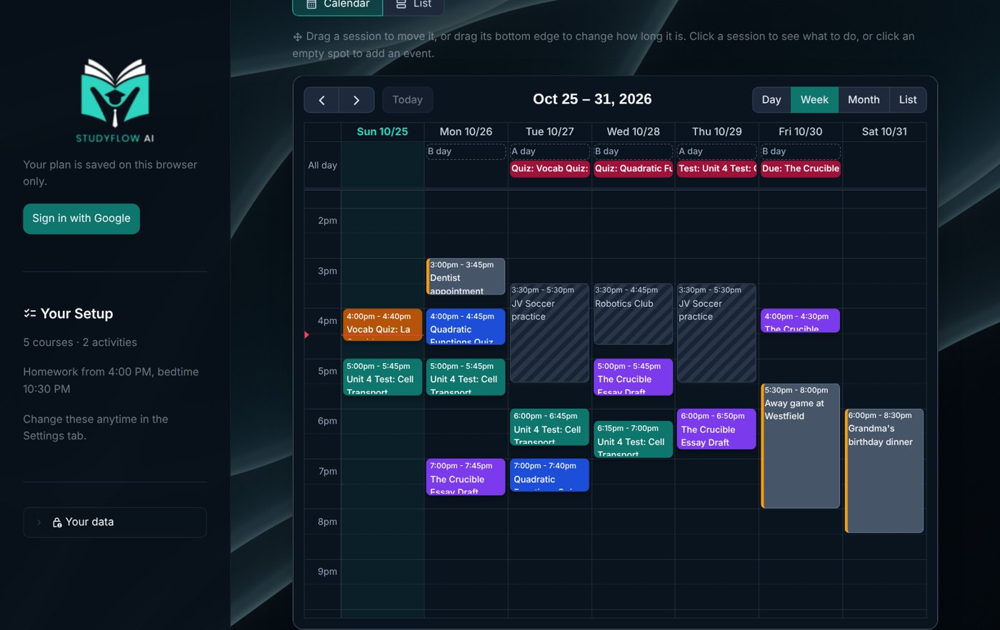
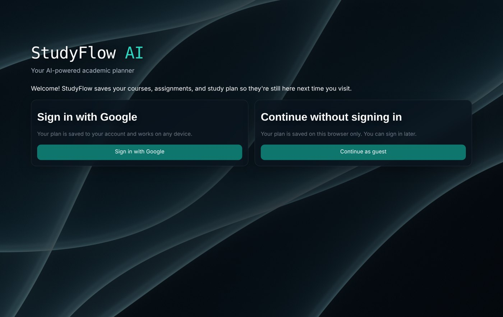
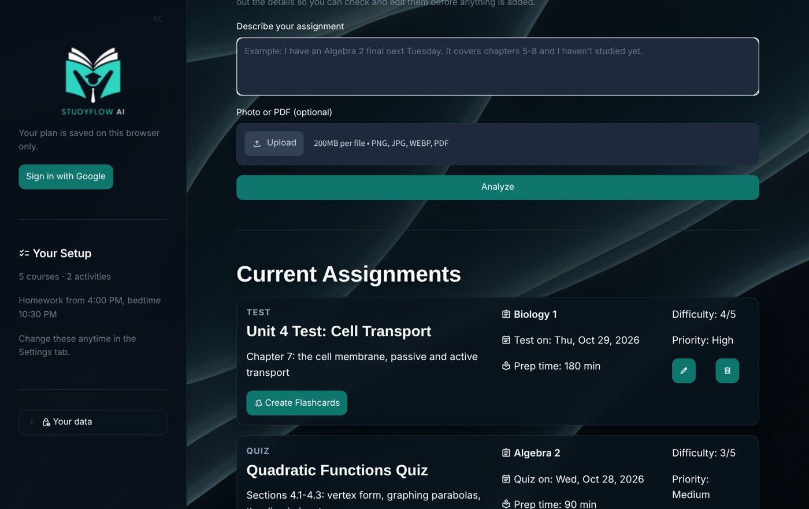
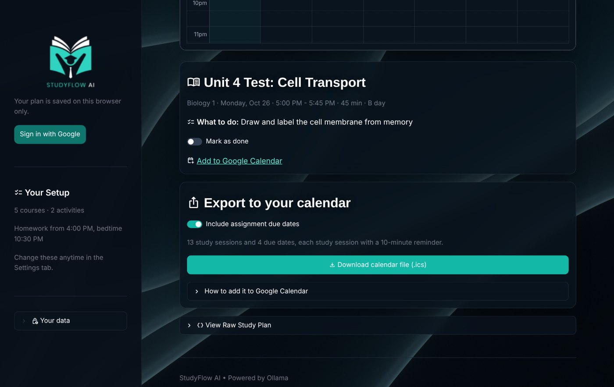
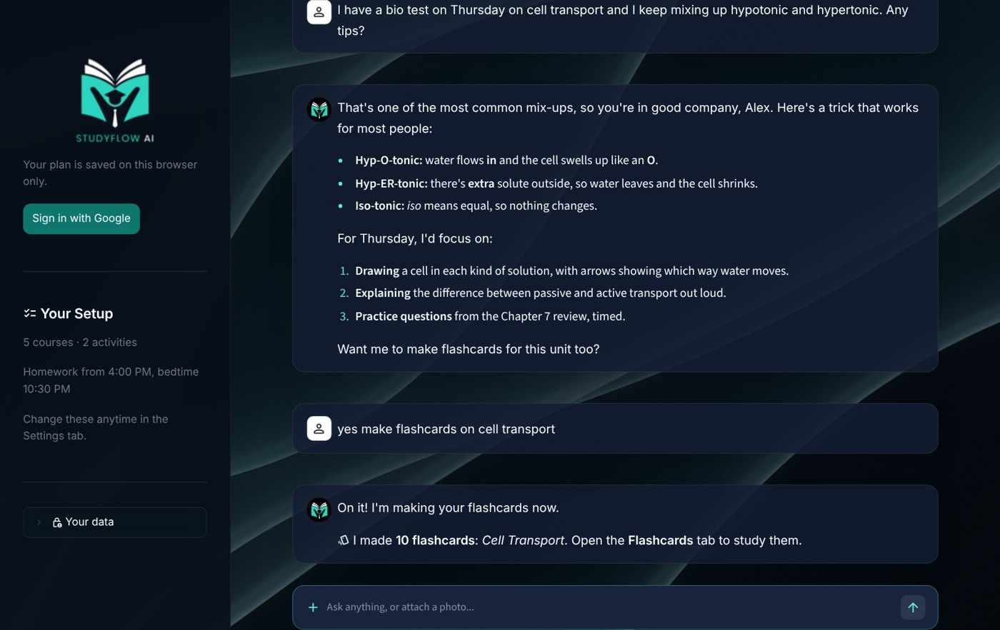
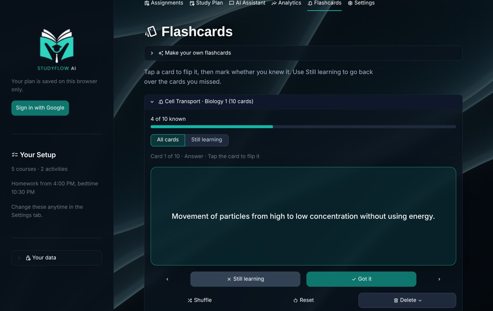
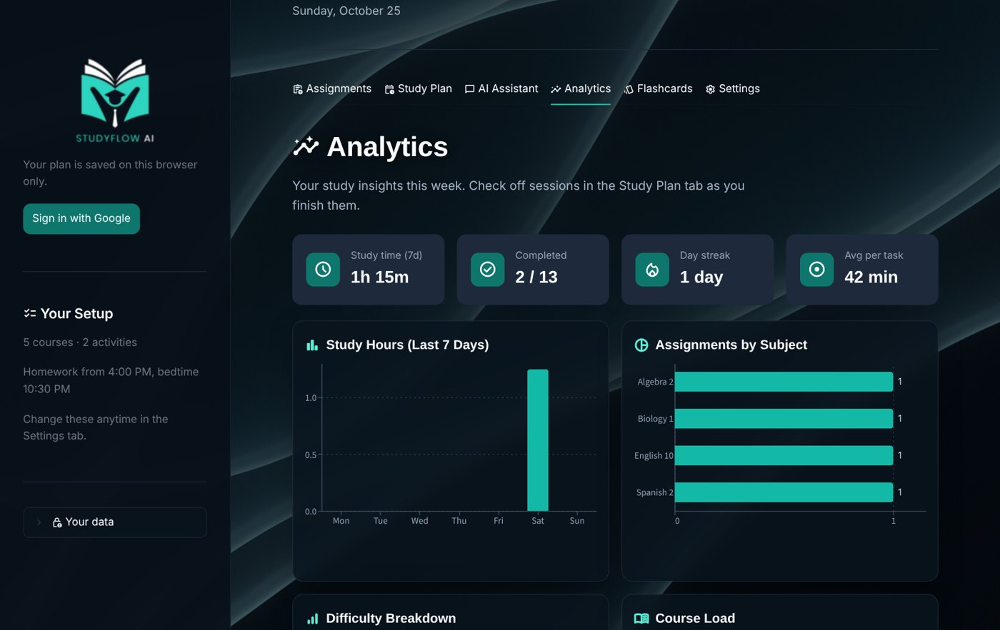
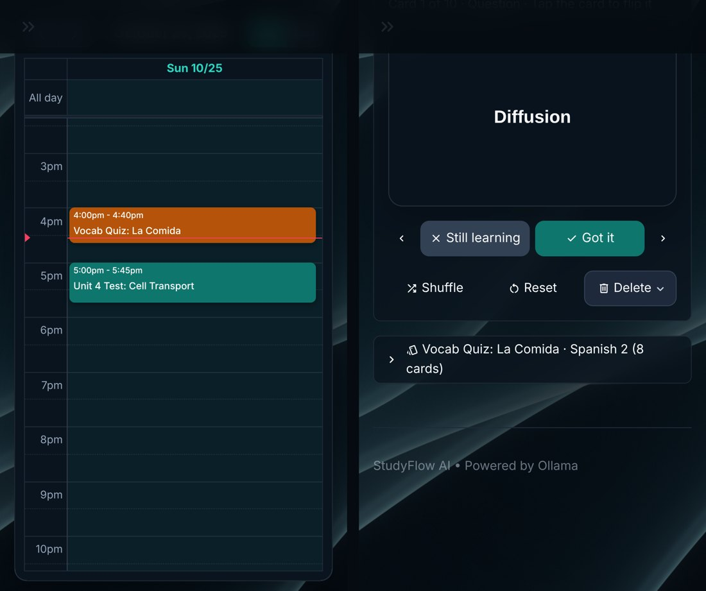
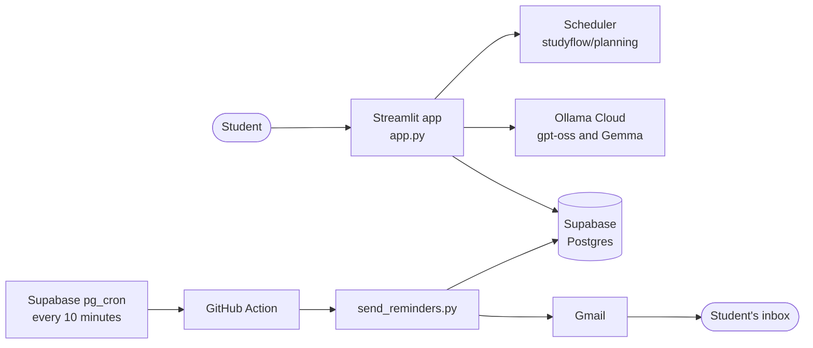

# StudyFlow AI

**An AI study planner that turns a student's assignments, classes, and after-school schedule into a realistic day-by-day study plan.**

**Try it:** [studyflowai26.streamlit.app](https://studyflowai26.streamlit.app)



---

## Why we built it

When we started high school as freshmen, we ran into the same problem as a lot of our classmates. Between tests, assignments, practice, and everything else going on, figuring out what to study and when felt almost impossible. We ended up staying up late to cram, falling behind in classes, and feeling stressed all the time. The apps we tried didn't help much: they weren't built for school, they left most of the planning to us, or they had no idea how to fit studying around our actual lives. So we built StudyFlow, a planner that does the planning for you.

The problem usually isn't effort. "Study for the bio test" is too big and too vague, and it has to fit around practice, club meetings, an A/B day schedule, and everything else due that week. Most planner apps leave the hardest part, deciding what to do and when, up to the student.

StudyFlow does that part. You tell it what's due (by typing it, or by snapping a photo of the assignment sheet) and it builds a plan around your real week: it knows when you get home, when you have practice, when you go to bed, and which classes meet on A days and B days at Fairfax County Public Schools. Each study session comes with a specific task, so you always know exactly what to work on.

---

## Features

### Guided setup
- A six-step setup: basic info, courses, activities, daily routine, study preferences, and daily email reminders.
- Search 400+ real FCPS middle and high school courses and mark which ones meet on A days or B days.
- Follows the FCPS 2026-27 A/B day calendar, including holidays, breaks, and early release days.
- Add sports, clubs, or a job, and set your homework start time, bedtime, dinner time, and a daily study limit.

### Add assignments any way you want
- Type it in plain English ("Algebra 2 final next Tuesday, chapters 5-8") or upload a **photo or PDF** of an assignment sheet, syllabus, or planner page.
- The AI pulls out every assignment with its course, type, due date, difficulty, and time estimate, plus the vocab, terms, and topics listed on the sheet. You review everything before it's added.
- Edit or delete any assignment later.

### A study plan that fits your real week
- A scheduler written in code (not AI) places each study session around your homework start time, weekly activities, one-time events, dinner, bedtime, daily study limit, breaks, and due dates. It also supports lighter Fridays, an optional Sunday catch-up day, and putting your hardest work at the time of day you focus best.
- The AI then writes a **specific task** for every session, like "Do the Chapter 7 review questions, check answers" instead of "Study biology."
- If something can't fit before its due date, StudyFlow tells you why and what to change.
- **Plans change, and so does yours.** Missed a session or forgot to add something? StudyFlow notices and offers to reschedule missed work or fit new assignments in, without moving the sessions you already planned or dragged. **Update my plan** also moves sessions that now clash with a new event and drops time you no longer need, and **Can't make it? Move it** on any session finds it a new time before the due date.

### Interactive calendar
- Day, week, month, and list views, like Google Calendar.
- **Drag** a session to move it, or drag its bottom edge to make it longer or shorter. Changes save instantly.
- Click any session to see what to do and check it off, or click a due date to see the assignment.
- Due dates, A/B days, and your activities show on the calendar, so you can see why sessions are where they are.
- Add **one-time events** like a dentist appointment, an away game, or a family trip by clicking or dragging on an empty spot in the calendar (or from the One-time events list). Your study plan works around them, and StudyFlow warns you if an event overlaps a study session.
- Export the whole plan as a calendar file (.ics) for Google Calendar, Apple Calendar, or Outlook, or add single sessions to Google Calendar with one click.

### AI Assistant
- A study chat that knows your classes, schedule, and assignments.
- Ask it to explain a topic, or attach a photo of a homework problem for a step-by-step walkthrough. It guides you through the steps instead of just giving the answer.
- It can run your planner from the chat. Tell it what's going on and it makes the change, then shows exactly what it did:
  - "Add my bio test on Friday" adds an assignment; "push my essay back two days" or "I turned in the essay" edits or removes one.
  - "I have a dentist appointment Tuesday at 3" or "I'm at a tournament all day Saturday" adds a one-time event; "cancel the dentist appointment" removes it.
  - "I finished yesterday's session" checks it off; "I missed it" or "I can't study Thursday" reschedules the work.
  - "Make me a study plan" or "start my plan over" builds or rebuilds the plan, and "limit me to 2 hours a day" changes your study settings.
  - "Make flashcards on the causes of World War I" makes a flashcard set.

### Flashcards
- Make a set from any assignment, from any topic you type, or from a photo or PDF of your notes.
- Cards are written to match your state's standards for your course and grade (the Virginia SOL for Virginia students), and use the actual vocab and topics from your assignment sheet.
- Tap to flip, mark **Got it** or **Still learning**, then practice just the cards you missed. Includes shuffle, progress tracking, and an end-of-round summary.

### Analytics
- Study time over the last 7 days, sessions completed, your day streak, and average time per task.
- Charts for study hours, assignments by subject, difficulty, and course load.
- A list of what's coming up in the next 7 days.

### Daily email reminders
- Turn them on during setup or in Settings, pick a time, and get a daily email with that day's study sessions and anything due in the next 3 days.
- Emails go out at the time you pick. If one can't be sent within 3 hours of it, StudyFlow waits for the next day instead of sending a morning reminder at night.
- Every email has a one-click unsubscribe link.

### Accounts and saving
- Sign in with Google to use StudyFlow on any device, or continue as a guest and your plan is saved for that browser.
- Everything is saved to a database automatically. You can delete all of your data at any time from the sidebar.

### Light and dark mode
- Pick **Light**, **Dark**, or **System** (follows your device) from the ⋮ menu in the top right. Streamlit remembers the choice on that browser.
- Both themes are set in [`.streamlit/config.toml`](.streamlit/config.toml), and the calendar, charts, animated background, and logo all switch with them.
- Type is set in Bricolage Grotesque for headings, Figtree for text, and JetBrains Mono for small labels.

### Works on phones
- The layout adapts to small screens: the calendar opens in day view, and tabs and buttons resize to fit.

---

## Screenshots

| | |
|---|---|
|  |  |
| **Sign in with Google or continue as a guest** | **Assignments, added by typing or from a photo or PDF** |
|  |  |
| **Click a session to see what to do, then check it off** | **The AI Assistant knows your classes and can make flashcards** |
|  |  |
| **Flashcards with Got it / Still learning** | **Analytics for the past week** |



*Screenshots use a made-up demo student.*

---

## How it works



1. **Setup** saves the student's profile, courses, activities, routine, and study preferences.
2. **Assignments** are read from text, photos, or PDFs by an AI model, then checked and cleaned up in code (valid dates, difficulty 1 to 5, course matched to the student's classes).
3. **The study plan** is built in two steps. First, `studyflow/planning/scheduler.py` places every session using rules, which takes seconds and always respects your schedule. Then an AI model writes a short, specific task for each session. We moved the scheduling itself out of the AI after it took over a minute and sometimes placed sessions at bad times.
4. **Everything is saved** to one row per student in Supabase. Guests are identified by a random token stored in a browser cookie, and only a hash of that token is stored in the database.
5. **Reminder emails** are sent by a GitHub Action that runs `send_reminders.py`. Supabase's built-in scheduler starts it every 10 minutes, and it emails anyone whose chosen time was within the last 3 hours and who hasn't gotten today's email yet.

### AI models

All AI runs through [Ollama Cloud](https://ollama.com).

| Model | Used for |
|---|---|
| `gpt-oss:20b-cloud` | Reading typed descriptions and PDFs, and making flashcards from text |
| `gemma4:31b-cloud` | The AI Assistant chat, reading photos (assignment sheets and notes), and writing session tasks |

AI requests have a time limit and are retried once if they time out. If the AI can't write a task for a session, the session still gets a simple default task, so the plan always works. Chat replies stream in as they're written.

---

## Project structure

```
app.py                      The Streamlit app: pages, tabs, and AI calls
send_reminders.py           Sends the daily reminder emails (run by the GitHub Action)
requirements.txt            Python packages

studyflow/
    planning/
        scheduler.py        Places study sessions around the student's week
        ab_calendar.py      FCPS 2026-27 A/B days, holidays, and early releases
        analytics.py        Numbers for the Analytics tab
        events.py           One-time events (appointments, games, trips)
    data/
        storage.py          Saving and loading students in Supabase
        uploads.py          Reading photos and PDFs
        fcps_courses.py     The FCPS course list
    ui/
        setup_forms.py      The setup wizard and Settings forms
        plan_calendar.py    The interactive study plan calendar
        flashcard_display.py  Making and studying flashcards
        glass_background.py The animated background
    exports/
        calendar_export.py  .ics calendar files and Google Calendar links
        reminder_email.py   Building and sending reminder emails

assets/
    images/                 Favicon and logo
    styles/                 app.css, calendar.css, glass.css
    scripts/                The animated background script and shaders

supabase/                   Database setup SQL
docs/screenshots/           Screenshots for this README
.github/workflows/          The reminder email schedule
.devcontainer/              Setup for GitHub Codespaces
.streamlit/config.toml      Theme color
```

---

## Running it locally

### What you need
- **Python 3.11 or newer**
- An **Ollama API key** (create an account at [ollama.com](https://ollama.com), then make a key in your account settings)
- *Optional:* a [Supabase](https://supabase.com) project for saving data. Without it the app still runs, but nothing is saved.
- *Optional:* Google sign-in and Gmail settings (see below)

### Steps

```bash
git clone https://github.com/dharshan-can-code/studyflow-ai.git
cd studyflow-ai
python -m venv .venv
source .venv/bin/activate        # On Windows (Git Bash): source .venv/Scripts/activate
pip install -r requirements.txt
```

Create a file at `.streamlit/secrets.toml` with your own values:

```toml
OLLAMA_API_KEY = "your-ollama-key"

SUPABASE_URL = "https://your-project.supabase.co"
SUPABASE_SECRET_KEY = "your-supabase-secret-key"

GMAIL_ADDRESS = "your-reminder-account@gmail.com"
GMAIL_APP_PASSWORD = "your-16-letter-app-password"
APP_URL = "http://localhost:8501"

[auth]
redirect_uri = "http://localhost:8501/oauth2callback"
cookie_secret = "any-long-random-string"
client_id = "your-google-client-id"
client_secret = "your-google-client-secret"
server_metadata_url = "https://accounts.google.com/.well-known/openid-configuration"
```

Only `OLLAMA_API_KEY` is required. Leave out the Supabase lines to run without saving, the Gmail lines to turn off reminder emails, and the `[auth]` section to hide Google sign-in.

> **Keep `[auth]` at the bottom.** In TOML, every line after `[auth]` belongs to that section, so keys placed below it (like the Gmail ones) won't be found.

`secrets.toml` is in `.gitignore`. Never commit it.

Then start the app:

```bash
streamlit run app.py
```

It opens at http://localhost:8501.

---

## Setting up the database

1. Create a project at [supabase.com](https://supabase.com).
2. Open the **SQL Editor** and run [`supabase/schema.sql`](supabase/schema.sql). It creates the `students` table with every column the app uses.
3. Copy the project URL and the **secret** (service role) key into `secrets.toml`. This key only ever lives on the server.

If your database was created with an older version of StudyFlow, run the update files instead, in this order: `add_setup.sql`, `add_reminders.sql`, `add_flashcards.sql`. Each one is safe to run more than once.

---

## Google sign-in

StudyFlow uses Streamlit's built-in login (`st.login`).

1. In the [Google Cloud Console](https://console.cloud.google.com/apis/credentials), create an **OAuth client ID** of type **Web application**.
2. Add `https://<your-app-url>/oauth2callback` (and `http://localhost:8501/oauth2callback` for local testing) as an **authorized redirect URI**.
3. Put the client ID and secret in the `[auth]` section of your secrets, with `redirect_uri` set to the same URL.

When a guest signs in with Google for the first time, their guest data moves into their Google account.

---

## Email reminders

Reminders are sent from a Gmail account by a GitHub Action ([`.github/workflows/reminders.yml`](.github/workflows/reminders.yml)).

1. Use a Gmail account with 2-step verification turned on, and create an **app password** (search "App passwords" in your Google Account settings).
2. In the GitHub repo, go to **Settings > Secrets and variables > Actions** and add these five repository secrets: `SUPABASE_URL`, `SUPABASE_SECRET_KEY`, `GMAIL_ADDRESS`, `GMAIL_APP_PASSWORD`, `APP_URL`.
3. Make the reminders run on time. The workflow has a 15-minute schedule, but GitHub often starts scheduled runs hours late, so something else needs to start it:
   - Create a GitHub **fine-grained token** for this repository with **Actions: Read and write** permission.
   - Open [`supabase/reminder_trigger.sql`](supabase/reminder_trigger.sql), paste the token where it says `PASTE_GITHUB_TOKEN_HERE` (and change the repository name if yours is different), and run it in the Supabase **SQL Editor**. Supabase then starts the workflow every 10 minutes. Don't commit the file with your token in it.
   - Or use any free cron service (like cron-job.org) to send a `POST` every 10 minutes to `https://api.github.com/repos/<owner>/<repo>/actions/workflows/reminders.yml/dispatches` with the body `{"ref": "main"}` and the headers `Authorization: Bearer <token>` and `Accept: application/vnd.github+json`.
4. GitHub only runs workflows from the default branch, so merge changes to `main` before expecting them to run. To test right away, open the **Actions** tab, pick **Send study reminders**, and click **Run workflow**.

Students turn reminders on during setup or in **Settings > Reminders**, where they can pick a time and send themselves a test email. The test email uses the Gmail settings in the app's own secrets.

---

## Deploying

The live app runs on [Streamlit Community Cloud](https://streamlit.io/cloud):

1. Create an app from this repository with `app.py` as the main file.
2. Paste the contents of your `secrets.toml` into the app's **Secrets** settings, using your app's real URL for `APP_URL` and `redirect_uri`.
3. Streamlit Cloud redeploys automatically when `main` changes. The app also reloads its helper files when they change, but if something looks out of date after a push, use **Reboot app**.

---

## Privacy and data

- Each student's courses, assignments, study plan, events, chat history, and flashcards are stored in one database row.
- Guests are identified by a random browser cookie. Only a hash of it is stored.
- Text and photos sent to the AI are processed by Ollama Cloud.
- Photos and PDFs you upload are only used for that one request and are **not saved**. Only the assignments or flashcards made from them are kept.
- Students can delete all of their data at any time from **Your data** in the sidebar.
- Reminder emails only go to students who turn them on, and every email has an unsubscribe link.
- API keys and passwords live only in Streamlit and GitHub secrets, never in the code.

---

## Built with

- [Streamlit](https://streamlit.io): the app framework
- [Ollama Cloud](https://ollama.com): AI models (`gpt-oss`, `gemma4`)
- [Supabase](https://supabase.com): the database
- [FullCalendar](https://fullcalendar.io), through [streamlit-calendar](https://github.com/im-perativa/streamlit-calendar): the study plan calendar
- [Altair](https://altair-viz.github.io): analytics charts
- [pypdf](https://pypdf.readthedocs.io) and [Pillow](https://python-pillow.org): reading PDFs and photos
- [streamlit-cookies-controller](https://github.com/NathanChen198/streamlit-cookies-controller): guest sign-in
- [Authlib](https://authlib.org): Google sign-in
- GitHub Actions and Gmail: reminder emails
- [Material Symbols](https://fonts.google.com/icons) and Google Fonts (Inter, Sora, Sixtyfour, DM Mono)
- The animated background is based on the GlassFold shader from [GradFlow](https://gradflow.meerbahadin.dev)

A/B days and school holidays come from the FCPS 2026-27 school year calendar, and the course list comes from the FCPS program of studies.

---

## Use of AI

StudyFlow uses AI models (listed above) to read assignments, write study tasks, power the AI Assistant, and make flashcards.

We also used AI coding assistants, including Claude, while building StudyFlow, to help write, debug, and test parts of the code.

---

## Team

- **Dharshan Shanmuganathan** · [dharshan-can-code](https://github.com/dharshan-can-code)
- **Avyan Basotia** · [avyanbasotia](https://github.com/avyanbasotia)
- **Haricharan Parna** · [haricharanparna](https://github.com/haricharanparna)
- **Vedant Kadalli** · [picturecube](https://github.com/picturecube)
